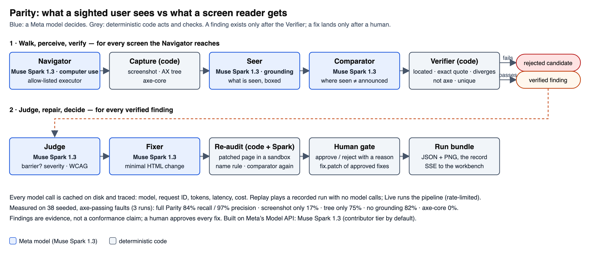

# Parity

**An agent that walks a site's key flows and compares what a sighted user sees with what a screen-reader user gets.** It finds the barriers axe-core misses, proves each one against the page's own accessibility tree, proposes a fix, re-checks it, and leaves the decision to a human.

Built this week (26 Oct – 4 Nov 2026) for the Meta Global AI Developer Hackathon on Meta's **Muse Spark 1.3**. Pre-existing open source: Playwright, axe-core and the usual web stack — listed in [HACKATHON_SCOPE.md](HACKATHON_SCOPE.md). Everything else in this repository was written during the event.

## Try it

- **Hosted demo:** _added after the first deploy (docs/23 §6, Task 22)_. No login. Press **Run the audit** with **Replay** selected: a recorded run plays back with no model calls. **Live** runs the real pipeline against the bundled store and is rate-limited per visitor.
- **Locally, in three commands:**

```bash
cp .env.example .env        # add MODEL_API_KEY for Live mode; Replay works without it
```
```bash
make setup                  # Homebrew python@3.12, node, uv; venv; Chromium; web deps; builds the workbench
```
```bash
make demo                   # serves http://127.0.0.1:8080 and opens it
```

Tests: `make test` (pytest, including browser smoke tests) and `make test-web` (vitest). The eval: `.venv/bin/python -m eval.harness --ablations --runs 3` (live; costs about $1.50 per run set).

## What you will see

axe-core reports **0 violations** on the demo checkout. Parity's Replay then shows seven verified findings on that page. The one it opens on: a sighted shopper sees a button that says **Pay R1,249**; a screen reader announces **button, "Submit"**. Five green ticks say why that is a finding and not a guess: the box landed on a real element, the quoted role and name equal the accessibility tree exactly, the visible text differs from the name, axe does not already report it, and it is not a duplicate. The judge rates it serious (WCAG 2.5.3, Label in Name), the fixer proposes a one-line change, the re-audit loads the patched page in a sandbox and the screen reader now says "Pay R1,249". You approve it with a reason, and **Download fix.patch** gives you a diff that applies to `store/`.

The Purchase flow (one pick away) is the agent walk: Muse Spark's computer use takes the store from product to order confirmation in nine turns, auditing each screen on the way (35 verified findings over four screens in the recorded run).

## Architecture



**How it acts.** The model decides; allow-listed code acts. Muse Spark's computer-use output is a list of actions; a small executor runs only the kinds it knows (click, type, key, scroll, wait, screenshot) and only inside the allowed origin. Two gated function tools, `audit_view` and `finish`, are refused with feedback when their preconditions do not hold (a screen must be audited before the walk moves on; `finish` is refused until the current screen is audited). On a third-party site (CLI only, never from the hosted app) a read-only guard refuses anything that looks like a purchase, a sign-up or a form submission, and a bot wall ends the run as `blocked by site`.

**What is deterministic.** Capture (screenshot, Chrome's accessibility tree with boxes, axe-core), the Verifier's five checks, the re-audit's name rule, the human gate, the patch export, the Replay, and the eval's matching are code. A finding cannot exist without passing the Verifier, and nothing is applied to a page without a human approving it.

## Meta capabilities, and why each is load-bearing

| Capability | Where | Why Parity does not work without it |
|---|---|---|
| **Muse Spark 1.3 · computer use** | Navigator | Reaches the screens a fixed script would not (quantity changes, a payment form filled in, the confirmation), with every batch screened by code. |
| **Muse Spark 1.3 · perception grounding** (0–1000 boxes) | Seer | Turns the screenshot into *what a sighted user sees, where*; the Verifier can only check a claim that comes with a box. |
| **Muse Spark 1.3 · multimodal comparison** | Comparator | Reads the screenshot and the accessibility tree together and names where they disagree, quoting the tree exactly so code can verify the quote. |
| **Muse Spark 1.3 · a separate judge call** | Judge | Severity and WCAG, fails closed to "needs review"; Muse Wonder 1.0 was measured as an alternative judge (same agreement, 2.3× the cost). |
| **Muse Spark 1.3 · fixer and re-audit** | Fixer, Re-audit | A minimal HTML change, then the comparison run again on the patched page in a sandbox. |

Contributor tier by default (the same model at about a twelfth of the price); a private mode switches every stage to standard `muse-spark-1.3`. Every stage shows its model badge in the workbench, and the trace drawer lists every call with its model, request ID, tokens, latency, cost and cache state. Real screen-reader audio (VoiceOver clips transcribed by Muse Voice Transcribe) is planned but **not yet built**; this README will say so if it lands.

## Evaluation

Measured on the bundled store: **38 seeded faults of the kind axe-core passes, 20 clean controls**, labels kept outside the agent's code path. A finding is scored under its element's id (or the nearest id above it); four pages, three runs per configuration, effort medium. The numbers below are copied from [eval/results/latest.md](eval/results/latest.md) (commit `1e6caad`, 1 Nov) and are the only number set quoted anywhere.

| System | Recall | Precision | Verified findings | FP on clean | Cost / page set | Time |
|---|---|---|---|---|---|---|
| **Parity (full)** | **84%** | **97%** | 33 per run · 38 labels | 0.0 | $0.37 | 281 s |
| screenshot only (no tree) | 17% | 95% | 7 per run | 0.0 | $0.08 | 391 s |
| tree only (no screenshot, no grounding) | 75% | 98% | 29 per run | 0.3 | $0.32 | 442 s |
| no grounding (no Seer) | 82% | 95% | 33 per run | 0.7 | $0.36 | 428 s |
| axe-core 4.14 | 0% | — | 0 violations | — | $0 | — |

How to read it: the accessibility tree carries most of the recall; the screenshot alone finds little because the Verifier rejects what cannot be quoted from the tree; grounding adds two points of recall and removes 0.7 false positives on clean controls per page set; precision stays at or above 95% in every configuration because the Verifier gates all four (the "Without the Verifier" switch in the workbench shows what a run would have reported without it). axe-core's 0% is by construction: the faults were chosen to pass it. Judge: Spark and Wonder each agree with the labels on 94% of the same 33 findings. Three runs is a small sample; the spread between runs was two to three labels per page set. Full method and caveats: [docs/17](docs/17-validation-results.md).

**Real-world sample** (read-only, anonymised, CLI only): Site A, two screens, six verified findings (five CSS-drawn star ratings that announce nothing; axe reports none of them). Site B: a bot challenge in front of the first page ended the run before anything was sent to a model.

## Observability

Every run is a bundle on disk (or in a Cloud Storage bucket): `run.json`, each screen's screenshot, accessibility tree, axe result and served source, each finding and rejected candidate, `trace.jsonl` (every model call) and `events.jsonl` (what the workbench streamed). Replay plays a committed bundle back; a run's URL reopens it with its decisions. The SQLite index is a cache rebuilt at boot.

## Repository

| Path | What |
|---|---|
| `parity/` | the agent and server: FastAPI, Playwright, the pipeline stages, run bundles, the SQLite index |
| `web/` | the workbench (React, Vite, Tailwind), built into `parity/static` |
| `store/` | the ShopRight demo store: static pages with seeded, axe-passing faults |
| `eval/` | labels, the harness, the ablations and the results (`eval/results/latest.md`) |
| `fixtures/replay/` | the recorded runs served in Replay mode (two heroes, two anonymised public samples) |
| `deploy/` | Dockerfile companions: the Cloud Run script and its README |
| `tests/` | pytest and vitest; model-facing code runs against recorded responses in `tests/fixtures/meta` |
| `docs/` | decisions, design spec, plan, validation and QA reports ([docs/README.md](docs/README.md)) |

## Limits

- Findings are evidence, **not a conformance claim**, and no fix is applied without a human; Parity never reports "compliant".
- The eval runs on our own store with faults chosen to pass axe; it says nothing about axe in general, and n is small.
- The prompts do not yet mark page text as untrusted. Hosted Live mode is restricted to our own store; public sites are audited only from the command line, behind the read-only guard.
- Model-facing tests answer from recorded stage responses, not prompt-keyed fixtures; the live smoke run and the eval are the prompt-regression checks.
- One Live run at a time, a few per visitor per hour, a 15-minute cap per run; Replay is unlimited.

## Licence

MIT for everything written here. Playwright (Apache-2.0), axe-core (MPL-2.0) and the other dependencies keep their own licences; see [HACKATHON_SCOPE.md](HACKATHON_SCOPE.md).
