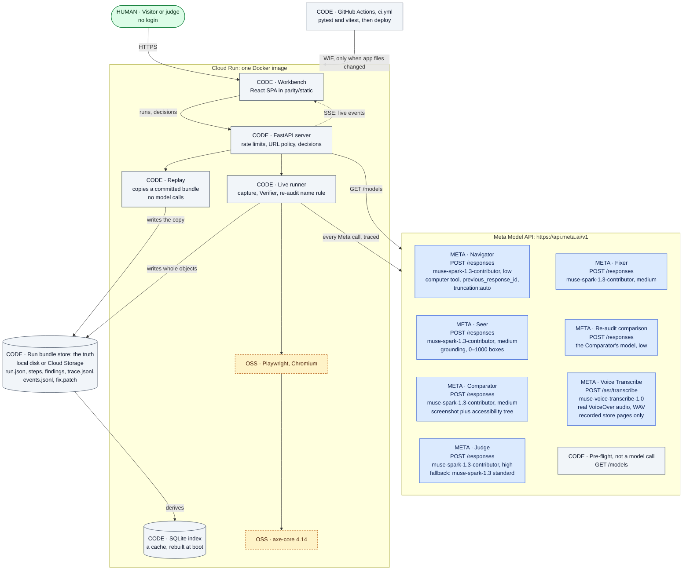
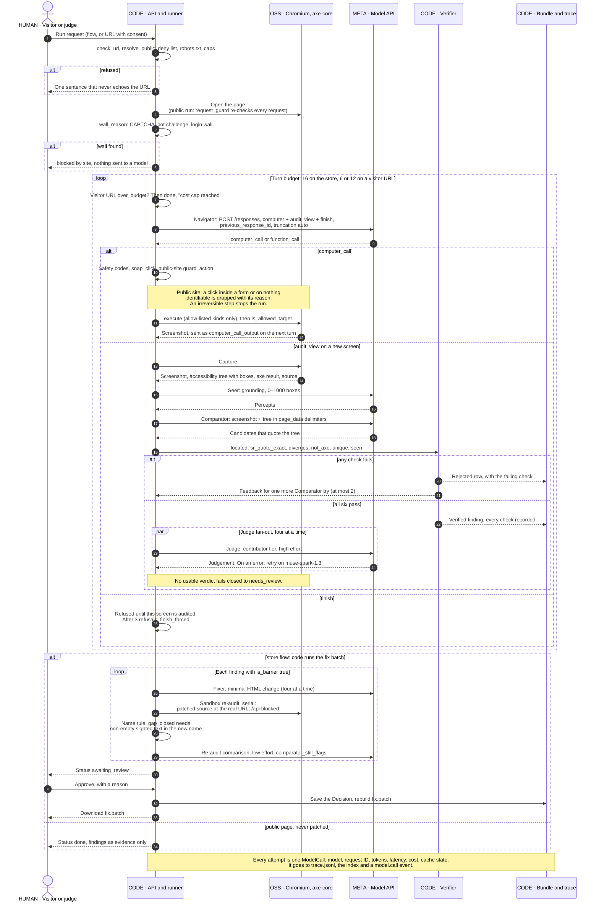
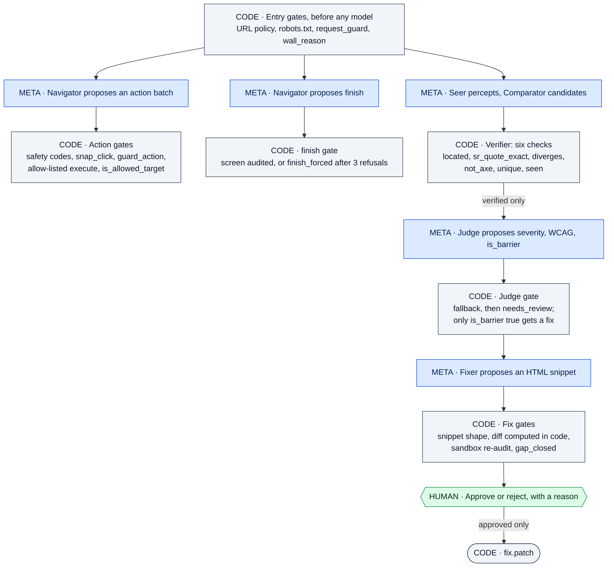
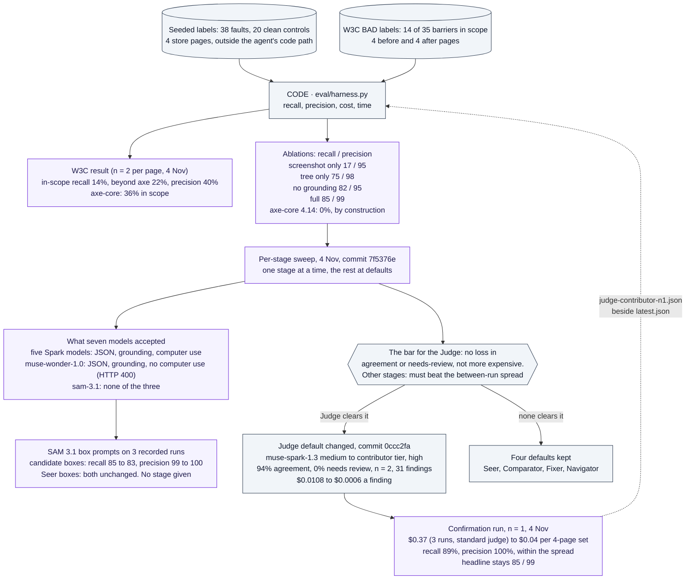

# 31 — Architecture and Meta Model API integration

For a Technical Depth reader. Labels match the code at commit `2039a9f`, the commit the final hosted revision `parity-00023-qkh` serves (its code is identical to `0ccc2fa`). Where an older document differs, `parity/config.py` and `parity/meta/client.py` win. Measured numbers come only from [eval/results/latest.md](../eval/results/latest.md), [eval/results/model-sweep.md](../eval/results/model-sweep.md) and the [hand-off](30-final-dev-handoff.md), each with its n and date. Findings are evidence, not a conformance claim, and a human approves every fix.

In the diagrams, `META` is a Meta model call, `CODE` is deterministic code written this week, `OSS` is pre-existing open source, and `HUMAN` is a person's decision. The prefix carries the meaning; the colour only repeats it. In section 4, the unprefixed purple nodes are measured results.

## 1. System and integrations map

- Replay is the default for judges: it copies a committed bundle from `fixtures/replay` under a new id and calls no model.
- Live runs the real pipeline: the store flows, the W3C demo pages, or one public page a visitor chooses. The last two are read-only and have no Fixer or Re-audit.
- `model_for(stage)` is the one place a stage learns its model ID. `PARITY_PRIVATE=true` moves every contributor-tier stage to standard `muse-spark-1.3`.
- The bundle is the truth and the index is a disposable cache. Every write goes to the bundle first.
- CI's `changes` step skips the build and deploy when a push touches only `docs/`, `.superpowers/`, `.github/` or `*.md`. Deploy authenticates by Workload Identity Federation, with no stored key.
- Trace check: bundles recorded before `0ccc2fa` (both heroes and the four W3C pages) show the standard-tier judge in their traces. The first run with the contributor judge in its trace is the fresh-clone Live checkout, `20261104-151555-37c262e1` (hand-off §3, §5).

## 2. One Live run, from URL entry to approval

- Code runs the audit in a fixed order. The model chooses only where to navigate and when to audit.
- Order inside a batch, as in `run_agent`: safety codes, `snap_click` (a near miss within 20 px moves to its control), `guard_action`, `execute`, origin check, `wall_reason` again.
- Measured on the recorded purchase bundle (one run, 4 Nov): nine turns, 30 verified, 4 rejected, 27 fixes, 27 re-audits, 14 closed, $0.373, 1,343 s, of which the serial re-audit took 669 s (hand-off §4).
- Caps: 3 Live runs per IP per hour, hosted and local. Hosted visitor-URL runs also have $0.50 a run, $5 a day and 3 per origin a day (hand-off §5, §7).
- Known limits (hand-off §6): the per-run cost cap is not checked inside the judge fan-out; robots.txt is read at start and landing only; a login wall needs a password field plus a login title or path.

## 3. Trust boundaries

- A finding cannot persist without passing the Verifier. A failed candidate is kept as a visible rejected row, not dropped.
- Page text reaches the models inside `page_data` delimiters as evidence. If a model obeys a page anyway, the action gates still refuse the irreversible step (test fixture `tests/fixtures/pages/injection.html`).
- The Judge's model is decided by config, not by the model: `muse-spark-1.3-contributor`, then `muse-spark-1.3` on an error.
- Stated limits (hand-off §6): `seen` stands down when the sighted pass did not run; judge output is not validated for shape (severity and WCAG refs).
- Also stated: the snippet gate checks shape, not meaning; fixes are shown before their re-audit runs, and a failed re-audit leaves a fix approvable. The human is the last gate, not a formality.

## 4. The eval feedback loop

- Provenance: the full row (3 runs, standard-tier judge) and the W3C block (2 runs per page) are 4 Nov at commit `3221905`. The three ablation rows keep their 1 Nov measurement at commit `1e6caad`.
- The two cost figures are not one experiment: $0.369 is the mean of 3 runs with the standard judge, and $0.043 is n = 1 with the contributor judge. The 85 / 99 headline was not re-measured on the new judge.
- Judge caveat: severity matches the old judge on 84% of findings, and the standard tier's own low and high variants match it on 84% and 87%. At medium, the same contributor model agrees with the labels on only 90%, at the same $0.0006.
- Comparator and Seer: nothing beats the default by more than the spread of 3 labels. Contributor tier at high (88 / 98, n = 2) and Wonder (88 / 97, n = 2) are inside it.
- Fixer: Wonder closes 62% of gaps at $0.0252 a fix against the default's 53% at $0.0004 (n = 2, 29 barriers), so the default stays. Read gaps closed beside "Comparator still flags": 2% against 14%.
- Navigator: every row reached 4 of 4 screens, and the default's 11 turns are inside its spread of 2. These walks ran with twelve turns, before the click correction, and were not re-measured.

## 5. Every Meta capability

| Stage | Model and tier | Effort | API feature used | Code that checks its output | Evidence |
|---|---|---|---|---|---|
| Navigator (traced as stage `auditor`) | `muse-spark-1.3-contributor` | low | `POST /responses`; `computer` tool with function tools `audit_view` and `finish`; `previous_response_id`; `truncation: "auto"`; `parallel_tool_calls: false` | Safety codes, `snap_click`, `guard_action`, allow-listed `execute`, `is_allowed_target`, `wall_reason`, the `finish` gate | Sweep (n = 2, 4 Nov): 4 of 4 screens, 11 turns, $0.004. Tests: `test_guard` |
| Seer | `muse-spark-1.3-contributor` | medium | `POST /responses`; screenshot input; perception grounding, 0–1000 boxes | Verifier `seen` (a candidate needs a percept behind it) and `located` | Ablation: no grounding 82 / 95, 0.7 FP on clean; full 85 / 99, 0.0 FP (`latest.md`) |
| Comparator | `muse-spark-1.3-contributor` | medium | `POST /responses`; screenshot and accessibility tree together; at most 2 tries with Verifier feedback | All six Verifier checks | Sweep (n = 3, 4 Nov): 85 / 99, 10% rejected. Ablations: tree only 75 / 98, screenshot only 17 / 95 |
| Judge | `muse-spark-1.3-contributor`; fallback `muse-spark-1.3` (standard) | high | `POST /responses`; JSON answer; a separate call per verified finding, four at a time | Fails closed to `needs_review`; only `is_barrier` true reaches the Fixer | Sweep (n = 2, 31 findings): 94%, 0% needs review, $0.0006. Confirmation (n = 1, 34 findings): 94%, 32 of 34. Tests: `test_config` |
| Fixer | `muse-spark-1.3-contributor` | medium | `POST /responses`; returns a minimal HTML change | Snippet gate (shape), diff computed in code, then the Re-audit | Sweep (n = 2, 29 barriers): 53% of gaps closed, 14% still flagged, $0.0004 a fix |
| Re-audit comparison | The Comparator's model (`muse-spark-1.3-contributor`) | low | `POST /responses`, on the patched page in a sandbox | `gap_closed` name rule in `parity/pipeline/reaudit.py`; the model's answer is recorded as `comparator_still_flags` | Purchase bundle (one run, 4 Nov): 27 re-audits, 14 closed. Tests: `test_reaudit` |
| Voice Transcribe | `muse-voice-transcribe-1.0` | n/a | `POST /asr/transcribe`; multipart `request` and `audio` (WAV, 16 kHz mono 16-bit); `keywords` | Word alignment against the phrases VoiceOver logged; the accessibility tree stays the record the Verifier checks | Word accuracy 0.92 on the committed checkout replay, Voice on five findings (hand-off §5). Recorded store pages only |
| Pre-flight | Not a model call | n/a | `GET /models` | `python -m parity.meta.client --check` exits non-zero unless `muse-spark-1.3` is listed; `/api/health` reports `models_ok` | Hosted `models_ok` true on `parity-00023-qkh` (hand-off §1) |
| Measured, no stage: Wonder | `muse-wonder-1.0` | medium | `POST /responses`: JSON and grounding accepted; `computer` refused with HTTP 400 | Same gates as the stage under test | Judge 94%, $0.0266 a finding (n = 1). Fixer 62%, $0.0252 a fix (n = 2) |
| Measured, no stage: SAM | `sam-3.1` | n/a | Box prompts, replayed on 3 recorded runs; returns boxes and masks, no text | Verifier and scoring run again on its boxes | Candidate boxes: recall 85 to 83, precision 99 to 100. Not tested: a Comparator shown SAM's boxes |

What every call shares, in `parity/meta/client.py`:

- **Cache:** keyed by SHA-256 of the model and the canonical body. A hit costs $0 and is traced with `cache_hit`. Chained agent turns are never read from or written to the cache, since a cached turn would chain a live call to a stale server-side response. An incomplete answer is never cached.
- **Retry:** 5 attempts, sleeping 1, 3, 9 and 20 s, on 429, 5xx and transport errors. Any other 4xx raises at once. One `ModelCall` is traced per attempt.
- **Secrets:** the key travels only in the `Authorization` header and is scrubbed from error strings. `Settings` keeps it out of `repr`.
